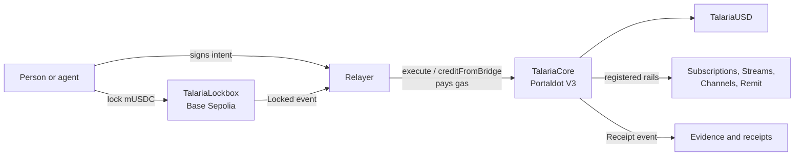

# Talaria

**Payments with wings.** An account-abstraction-style payment and agentic commerce layer for Portaldot: people and AI agents pay with signed intents, funded from another chain, gasless for the payer, policy-checked and receipted on-chain.

> Testnet only. tUSD and mUSDC are test tokens with no value. Built for the Portaldot Hacker House 2026, track: Multi-Chain & Cross-Chain Infra.

## Status at a glance

| Part | Status |
|---|---|
| Cross-chain checkout: lock on Base Sepolia, credit on Portaldot, gasless invoice payment | **Live on testnet** ([evidence](evidence/TRANSACTIONS.md)) |
| tUSD faucet, permit, transferFrom | **Live on testnet** |
| TalariaCore: refunds, session keys, policies, pending queue | Deployed, but these functions have only been exercised on a local chain |
| Subscriptions, streams, pay-per-call, remittance contracts | Built and tested on a local chain. **Not deployed**: storage deposits exceeded the tPOT available |
| Relayer, keeper, settler, SDK, agent, MCP server, demo API, web app | Built and tested as described under [How to test](#how-to-test). Only the relayer's bridge and intent paths have run against the live chain |

## Problem

Crypto payments ask too much of the payer: hold the right token on the right chain, keep gas on hand, and sign without limits. AI agents make this worse, because an agent needs to spend without holding an owner's whole key, and it needs to pay per API call without an on-chain transaction per call.

## Solution

Every payment follows one path, for a person or an agent:

```
Intent (signed) → Policy check → Execute → Receipt
```

A payer signs an EIP-712 intent, any relayer submits it and pays the gas, and the contract checks the signature, nonce, deadline and policy before moving funds and emitting a receipt.

### The five rails and the agent layer

| Rail | What it does | Contract |
|---|---|---|
| 1. Checkout | Invoices, payment links, full and partial refunds | `TalariaCore` |
| 2. Subscriptions | Merchant plans, permissionless charging when due, pause and cancel | `TalariaSubscriptions` |
| 3. Streaming | Per-second payments with computed accrual | `TalariaStreams` |
| 4. Pay-per-call | Prepaid channels with cumulative off-chain vouchers and batch redeem | `TalariaChannels` |
| 5. Remittance | Escrow to an address or a claim link, cancellable, refunds on expiry | `TalariaRemit` |

**Agent layer:** session keys with on-chain limits (per payment, per day, expiry, rails, payee), a queue for owner approval when a payment exceeds them, HTTP 402 paywalls, an Autopilot service and an MCP server.

## Architecture



More in [docs/ARCHITECTURE.md](docs/ARCHITECTURE.md).

## Why Portaldot

- **pallet-revive EVM on a Substrate chain.** Standard Solidity and viem run on Portaldot V3, and the SDK handles the H160 and SS58 account mapping, verified against accounts already mapped on-chain ([probe output](evidence/probe-chain.json)).
- **Storage deposits shaped the design.** A new slot locks about 3.84 tPOT, so receipts are events, structs are packed and pay-per-call settles with vouchers rather than per-call writes.
- **Multi-chain.** Base Sepolia funds pay for an invoice on Portaldot.
- **Ecosystem value.** An MIT-licensed SDK, address utilities and measured deployment costs that other Portaldot builders can reuse.

## Deployed contracts

**Portaldot V3 testnet** (chain ID `420420777`). There is no EVM explorer, so receipts are saved in [`evidence/`](evidence/). Details: [`deployments/portaldot-testnet.json`](deployments/portaldot-testnet.json).

| Contract | Address | Deploy transaction | Bytes | tPOT |
|---|---|---|---|---|
| TalariaUSD | `0x44bc5dcfba3f36fb03623a27e553cdbb0b8877f0` | `0xd8e98c3e75d7e3f4687b3149d59da74641538b6ee07658d6bb1af65772771d38` | 3,018 | 252.69 |
| TalariaCore | `0x69d4105479e25503f296797b91901ab558c830ac` | `0x28364ba30977ef1a97820d520eff7b77542fb9d6f8e0d6ac5d8bd6c5b6456222` | 8,539 | 683.89 |

**Base Sepolia.** Details: [`deployments/base-sepolia.json`](deployments/base-sepolia.json).

| Contract | Address | Deploy transaction |
|---|---|---|
| MockUSDC | `0x44bc5dcfba3f36fb03623a27e553cdbb0b8877f0` | `0x49941b0e06991949e90b9949a99b40f3c28abba69f9587b46627fae0ba14a315` |
| TalariaLockbox | `0x67e3e8d6185f2e57c60d63b81fc1376ff120b467` | `0x5a69a2b734e30c6ceb09ca26d4742b21e22667131daaaa1e5faa776ae68ad584` |

### Key live transactions

| Step | Chain | Transaction |
|---|---|---|
| Lock 10 mUSDC | Base Sepolia | `0x1e8fddc7ce961eee32eb158aeb1eeb8dd669b1f993366a9248ac013eb0d00364` |
| Relayer credits payer | Portaldot | `0xb0d9b610ecdb280b356c9be2c9919b4770f470b662ed9d0907297fa8be8e9bf1` |
| Payer with 0 tPOT pays invoice 1 by signed intent | Portaldot | `0x7fe8f26f10f5ad7f2e9a8a06348eef6ba26a0515697a778dd2e15059e45000ab` |

All transactions and costs: [evidence/TRANSACTIONS.md](evidence/TRANSACTIONS.md).

## Run locally

Requires Node 20+ and pnpm. Developed on Node 26.

```bash
git clone https://github.com/Stella112/Talaria.git
cd Talaria
pnpm install
cp .env.example .env
```

Web app (reads live testnet data, no key needed):

```bash
pnpm --filter @talaria-pay/web build
pnpm --filter @talaria-pay/web start
```

Relayer. Set `RELAYER_PRIVATE_KEY` in `.env`. Without `RELAYER_LIVE=1` it refuses every write. With it, it spends tPOT, up to `RELAYER_MAX_TX_PER_HOUR` transactions.

```bash
pnpm --filter @talaria-pay/relayer start
```

Demo paid API. Paid routes return `503` until the pay-per-call contract is deployed and `API_PROVIDER_ADDRESS` is set.

```bash
pnpm --filter @talaria-pay/demo-api start
```

Agent service and MCP server. Set `AGENT_SESSION_KEY` and `AGENT_OWNER` first. The agent works with no LLM. To add one, set `LLM_PROVIDER=openai-compatible`, `LLM_BASE_URL`, `LLM_API_KEY` and `LLM_MODEL`.

```bash
pnpm --filter @talaria-pay/agent start
```

```bash
pnpm --filter @talaria-pay/mcp start
```

## How to test

```bash
pnpm test
```

This runs the Hardhat contract and SDK integration tests on a local chain, and Vitest for the SDK utilities, relayer, agent, MCP server and demo API. The relayer, agent, MCP and API suites use stubs or a fake chain where their test files say so.

Read-only checks against the live chain, which spend nothing:

```bash
pnpm probe
```

## How a judge can try it

1. **See it without a wallet:** open the web app, whose Status page reads the chain live, then open `/pay/1` to see invoice 1 and who paid it.
2. **Check the evidence:** look up any hash above through the RPC at `https://test-evm-rpc-v3.portaldot.dev`, or read the saved receipts in `evidence/`.
3. **Use a wallet:** add a network with chain ID `420420777` and that RPC URL. The app switches networks for you. Signing with the app is gasless for you, but the relayer must be running and funded. It currently has very little tPOT, so new gasless actions may fail, and the Status page shows its live balance. `Claim 1,000 tUSD` is a direct transaction that needs your own tPOT.

## Trust assumptions and limitations

- **Trusted single relayer.** It can credit any user from the reserve, and it decides which locks to credit. It cannot take users' internal balances or forge their intents.
- **Admin control.** The owner can register rail contracts, which can move internal balances. A malicious owner could steal funds in this build.
- **Test tokens only**, and no third-party audit. `TalariaUSD` and the signature code are hand-written to save deposits.
- **Limited tPOT.** The testnet budget was 1,000 tPOT, which is why four rail contracts are not deployed.
- **Not ERC-4337.** This is account-abstraction-style: signed intents, session keys and sponsored gas through a relayer.

Full list: [docs/SECURITY.md](docs/SECURITY.md).

## Roadmap

1. Deploy the four remaining rails, and exercise session keys and refunds live.
2. Multi-signer bridge, and more source chains.
3. Independent audit, then Portaldot mainnet.
4. Merchant tools and hosted relayers.

## Credits & Dependencies

OpenZeppelin Contracts, Hardhat, viem, wagmi, Next.js, React, TanStack Query, Tailwind CSS, qrcode.react, @polkadot/api, @polkadot/util-crypto, Fastify, zod, MCP TypeScript SDK, dotenv, tsx, Vitest. Portaldot network details come from the hackathon page. Storage-deposit notes from the PortalNexus project guided early budgeting, and were then re-measured.

## Prior work

The design takes inspiration from Qevie, the author's earlier project on the QIE blockchain. All code in this repository is new and written during the event.

## License

[MIT](LICENSE)
