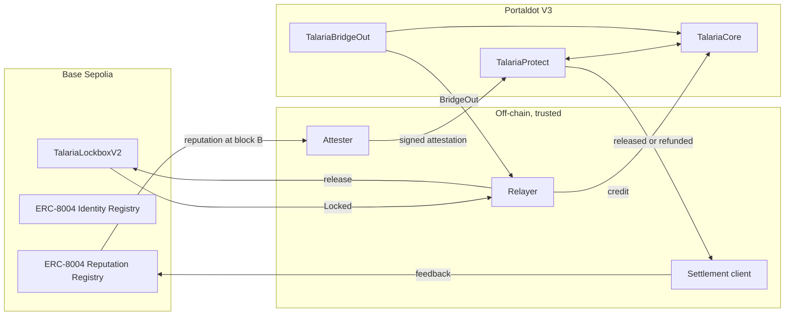

<p align="center"></p>

<h3 align="center">Stripe for Portaldot, with a refund button.</h3>

<p align="center">Crypto payments for people and AI agents. Proven sellers are paid instantly. New sellers' payments are held, so buyers can get their money back. Agents get spending limits that grow with their reputation.</p>

<p align="center">
  <a href="https://talaria-pi.vercel.app"><b>Live app</b></a> ·
  <a href="https://talaria-pi.vercel.app/agent">Try the agent, no wallet</a> ·
  <a href="https://youtu.be/31c2cLwA9Zs">Demo video</a> ·
  <a href="docs/Talaria-pitch-deck.pdf">Pitch deck</a> ·
  <a href="https://talaria-pi.vercel.app/docs">Docs</a> ·
  <a href="evidence/TRANSACTIONS.md">Every transaction</a>
</p>

> Testnet only. tUSD and mUSDC are test tokens with no value. Built for the Portaldot Hacker House 2026, track: Multi-Chain & Cross-Chain Infra. "Stripe" is only a comparison: Talaria has no link to Stripe.

## The problem

- **Crypto payments can't be undone.** If a seller doesn't deliver, the buyer has no way back. So people don't pay strangers, and everyday commerce stays away from crypto.
- **AI agents can't safely hold money.** Giving an agent a wallet gives it everything, with no limits and no audit trail.
- **Trust doesn't travel.** A seller's good record on one chain counts for nothing on another, and Portaldot merchants are cut off from buyers on other chains.

## The idea: trust-priced settlement

Reputation decides how fast money moves on Portaldot, and every outcome on Portaldot writes reputation back.

1. **Pay from anywhere.** Lock test USDC on Base Sepolia or BNB testnet, get credited on Portaldot, and pay with no gas. Bridge-out sends funds back to Base.
2. **Money that can come back.** Before a payment settles, an attester reads the seller's ERC-8004 reputation on Base. Proven sellers are paid instantly. New sellers' payments are held, so the buyer can dispute, and merchants can refund in full or in part at any time.
3. **Agents you can trust.** Session keys and signed mandates bind an agent to chosen merchants and amounts, and its spending cap rises with its own reputation.

When a payment is released, or a dispute ends in a refund, feedback is written back to Base. Reputation grows from what really happened, and it's portable.

## It works: real runs on testnets

| What happened | Proof |
|---|---|
| A new seller's payment was held, disputed and refunded in full. The refund went back to Base, and the seller got negative feedback | [Payment 4](https://talaria-pi.vercel.app/payment/4) |
| A seller with real history (score 100) was paid instantly, and got positive feedback | [Payment 5](https://talaria-pi.vercel.app/payment/5) |
| A merchant refunded part of a released payment | [Payment 6](https://talaria-pi.vercel.app/payment/6) |
| A wallet holding 0 tPOT paid an invoice from BNB testnet, through the website, with no gas | [Invoice 2](https://talaria-pi.vercel.app/pay/2) |
| Our hosted AI agent bought from a merchant after a visitor typed one sentence, with no wallet | [Agent](https://talaria-pi.vercel.app/agent) |

All hashes are below and in [evidence/TRANSACTIONS.md](evidence/TRANSACTIONS.md). They come from our own test runs, not customers.

## Status: what is live and what is not

| Part | Status |
|---|---|
| Base Sepolia → Portaldot checkout: lock, relayer credit, gasless invoice payment | **Live on testnet**, see [evidence](evidence/TRANSACTIONS.md) |
| `TalariaLockboxV2` on Base Sepolia | **Live.** Locks and a bridge-out release have gone through it |
| Trust-priced settlement: `TalariaProtect` and `TalariaBridgeOut`, mandates, holds, dispute, refund, bridge-out, feedback to Base | **Live on testnet, end to end**, see [evidence](evidence/TRANSACTIONS.md) |
| Subscriptions, streams, pay-per-call, remittance | **Live on Base Sepolia, not on Portaldot.** They run on a second copy of Core. Streams, subscriptions and remittance can be used from the website, and a user can settle their balance to Portaldot through the bridge as a separate step. Each step on Base needs Base test ETH. Pay-per-call runs through the SDK and scripts |
| Webhooks, idempotency | Built and tested with stubs. Not run against a real merchant |
| Hosted agent, relayer | **Running on a VPS.** The relayer's tPOT is limited, so gasless actions pause at a set floor |
| MCP server, x402 v2 headers | Built and tested locally |
| BNB testnet as a second source chain | **Live for funding in, including from the website.** A real wallet with 0 tPOT paid invoice 2 from BNB through the live checkout. The agent is registered there as id 2723. Bridge-out to BNB is enabled but has not been run |

**The live flow:** a new merchant's payment is held, disputed and refunded, the refund returns to Base, and negative feedback lands on Base. Then a merchant with real history settles instantly. Trusted Coffee's score of 100 comes from real settled demo purchases by us, not from customers.

## How trust-priced settlement works



More in [docs/ARCHITECTURE.md](docs/ARCHITECTURE.md).

**The score.** `score` is the average feedback from the Talaria settlement wallet, using the tag `talaria-settlement`, clamped to 0–100 and rounded down. A clean release counts 100, and a dispute refunded 50% or more counts 0. Fewer than 3 feedbacks is always New. Only our own wallet's feedback counts, which resists fake reviews but means this is not yet reputation from anywhere. It is a pure function: `scoreFrom` in `services/relayer/src/trust.ts`.

| Tier | Condition | Merchant's hold | Agent's cap per payment |
|---|---|---|---|
| Trusted | score ≥ 80, 3+ feedbacks | Instant (can still refund) | 100 tUSD |
| Established | score 50–79, 3+ feedbacks | 10 minutes | 25 tUSD |
| New | Anything else, or no attestation | 30 minutes | 5 tUSD |

These values are demo values, fixed at deploy. An agent's real cap is the lower of its tier cap and its mandate's maximum.

**Honest demo data.** Reputation in the demo comes only from real settled testnet payments created by demo runs, and each feedback record references its Portaldot transaction. The code refuses feedback with no settled transaction.

## Everything else Talaria does

| Feature | Contract |
|---|---|
| Internal accounts, gasless deposits, signed intents, session keys, approval queue, checkout, bridge credit, receipts | `TalariaCore` |
| Subscriptions | `TalariaSubscriptions` |
| Per-second streaming | `TalariaStreams` |
| Pay-per-call channels with cumulative vouchers | `TalariaChannels` |
| Remittance to an address or claim link | `TalariaRemit` |

Off-chain: a relayer (bridge, intents, keeper, settler), TypeScript SDK, hosted agent, MCP server, signed webhooks with idempotency keys, and a demo paid API returning real Portaldot chain data.

**Mandates and AP2/ACP.** A closed mandate binds a user's signature to the hash of a merchant-signed checkout, which is the same idea as AP2's cart mandate and ACP's single-use payment tokens. This is inspired by them, and **we do not claim compatibility** with either.

**x402.** The paywall sends and accepts the x402 v2 headers `PAYMENT-REQUIRED`, `PAYMENT-SIGNATURE` and `PAYMENT-RESPONSE`, following `specs/transports-v2/http.md` in the coinbase/x402 repository, with network `eip155:420420777`. The payment scheme, `talaria-channel`, is our own, so a client that only speaks the spec's `exact` scheme cannot pay it. `PAYMENT-RESPONSE` has an empty `transaction` because vouchers settle later in a batch. Whether this deferred form suits x402 facilitators is UNVERIFIED.

## Why Portaldot

Talaria needs a neutral place where value and reputation from different chains meet and settle. Portaldot V3 is that place.

- **EVM on Portaldot.** V3 runs standard Solidity through pallet-revive, so our contracts, Hardhat and viem work unchanged. Every protected payment, dispute, refund, mandate and bridge credit settles on Portaldot. Our address tools handle H160 and SS58 mapping, checked against accounts mapped on-chain ([probe](evidence/probe-chain.json)).
- **Multi-chain by design.** Funds come in from Base Sepolia and BNB testnet, and reputation is read from ERC-8004 on Base. Portaldot is where they come together, and where the outcome is decided.
- **Built for its costs.** A new storage slot locks about 3.84 tPOT, so Talaria verifies reputation inline instead of storing it, keeps payment history in events, and batches pay-per-call into single settlements.
- **Measured costs for other builders.** Deployment costs about 0.0781 tPOT per byte plus 17 per contract, fitted to our real deployments. See [docs/ARCHITECTURE.md](docs/ARCHITECTURE.md).
- **A shared layer for the ecosystem.** Any Portaldot app, from marketplaces to lending, can use the same payments and the same reputation instead of rebuilding them.

## Deployed contracts

**Portaldot V3 testnet** (chain ID `420420777`). There is no EVM explorer, so receipts are saved in [`evidence/`](evidence/).

| Contract | Address | Deploy transaction | Bytes | tPOT |
|---|---|---|---|---|
| TalariaUSD | `0x44bc5dcfba3f36fb03623a27e553cdbb0b8877f0` | `0xd8e98c3e75d7e3f4687b3149d59da74641538b6ee07658d6bb1af65772771d38` | 3,018 | 252.69 |
| TalariaCore | `0x69d4105479e25503f296797b91901ab558c830ac` | `0x28364ba30977ef1a97820d520eff7b77542fb9d6f8e0d6ac5d8bd6c5b6456222` | 8,539 | 683.89 |
| TalariaBridgeOut | `0x40b43930a97f328bc3325adb22ec0f01a5432320` | `0xb91d91e686f2275cce227b0437987498a5c1c1dbc4dabf7a1d976d02ee666570` | 1,161 | 103.82 |
| TalariaProtect | `0xc2e44329d071dd9683f2050e943dde19dac145e1` | `0xb702e7c29bccb15b55fa1bdc9b18405736272821a58e6ece0e08dfaa3355a692` | 8,401 | 673.18 |

**Base Sepolia**

| Contract | Address | Deploy transaction |
|---|---|---|
| MockUSDC | `0x44bc5dcfba3f36fb03623a27e553cdbb0b8877f0` | `0x49941b0e06991949e90b9949a99b40f3c28abba69f9587b46627fae0ba14a315` |
| TalariaLockbox (original) | `0x67e3e8d6185f2e57c60d63b81fc1376ff120b467` | `0x5a69a2b734e30c6ceb09ca26d4742b21e22667131daaaa1e5faa776ae68ad584` |
| TalariaLockboxV2 | `0xc8675f5a54bdfd78d6ffbed8551393c8e462b1bd` | `0xc55ec5fe5bc91ed22bbf528f1bb34e14fd1849713a0dd5a9241d22fdb419750d` |
| TalariaCore (Base copy) | `0x41b0e2fa8a49d5289f9f03b46228b6362da99455` | `0xe9e5c9098a38a4a51314cd6767d643960edef8813a50a57642b35f5102bb44ac` |
| TalariaSubscriptions (Base copy) | `0x394cb7bd33e1745a1f4b3d70bef7a8f742211627` | `0xc3e13f52bd4766cd5c1e3acca232ab2d347db2678fa9e5a6ffa6674903c0a4e6` |
| TalariaStreams (Base copy) | `0xf44780000c3b19f8dff8c08ba0b66518e8994a9f` | `0xbe6917c43aaa01ebdf2d6cb2aa4488f89ee2d6e513b860c96e2d3ce6b1dba473` |
| TalariaChannels (Base copy) | `0x31849ec8ed12c615c02292a664988281c0dece67` | `0xaced873177fd79c02e2fa51fd41b8f1312a92a751b3cb477aa784ae5ae9cc38c` |
| MockUSDC (BNB testnet) | `0x44bc5dcfba3f36fb03623a27e553cdbb0b8877f0` | `0x56a5534a57d785d534e02880e06f0569fe8ac166e308ad2b45263db11df2917b` |
| TalariaLockboxV2 (BNB testnet) | `0x67e3e8d6185f2e57c60d63b81fc1376ff120b467` | `0x236667084646108c3c79d04fdb60202f58dffad824fe235e371b27245e154986` |
| TalariaRemit (Base copy) | `0x126e6de91575c17d02d76b0f723c7bfab6c536d1` | `0xa52ed76315c96fe967c6ba9f1c5e9de1470c5421da703ce3eef77ad0d03854b4` |

**ERC-8004 registries used** (run by their maintainers, not by us): Identity `0x8004A818BFB912233c491871b3d84c89A494BD9e`, Reputation `0x8004B663056A597Dffe9eCcC1965A193B7388713`. We confirmed code at both addresses on Base Sepolia.

### Key live transactions

| Step | Chain | Transaction |
|---|---|---|
| Lock 10 mUSDC | Base Sepolia | `0x1e8fddc7ce961eee32eb158aeb1eeb8dd669b1f993366a9248ac013eb0d00364` |
| Relayer credits the payer | Portaldot | `0xb0d9b610ecdb280b356c9be2c9919b4770f470b662ed9d0907297fa8be8e9bf1` |
| Website checkout: lock 1 mUSDC, by a wallet with 0 tPOT | BNB testnet | `0xb2a6a7c9213874141e1d09e8f4406b2c1d333a1e4ab6d58b97f2396a80c48a37` |
| Credit | Portaldot | `0x7790b52017132f7c70db9c4e2f2eacda7664f954db8fca099827624a40be10f8` |
| Invoice 2 paid gaslessly | Portaldot | `0xc76af054c9140dd44abda6d7198a61a5d7895d57b8c9375cf97dbf2964b014f7` |
| Lock 2 mUSDC on BNB testnet | BNB testnet | `0xc210a9bb20b85c55b4868510be1259d33e6f1d80e1050fd1b372135c8b97e048` |
| Relayer credits it, source chain 97 | Portaldot | `0x34f3eb5c34f527da86940237f86bf1a9eeed94417f589639c9e30b063d63b0b8` |
| Payer with 0 tPOT pays invoice 1 | Portaldot | `0x7fe8f26f10f5ad7f2e9a8a06348eef6ba26a0515697a778dd2e15059e45000ab` |
| Agent buys from New Shop: held 30 min | Portaldot | `0x5f2abd215e1ade9126a89ead81717f9135a862eb11a4b5dc481092bf34af073e` |
| Buyer disputes | Portaldot | `0x803e74783c16aff7b821740284054c388e788fb4857f6fb0b68bc435dcda161b` |
| Arbiter refunds in full | Portaldot | `0x775a18c5d87ae0ac00710b5d8c4e67dbf319bc779d8be7736126cc457c5e1047` |
| Refund bridges out | Portaldot | `0xcb378549d30e76351f0a92c08e1ff237664fd7d93b876757c8d1f006c54670b9` |
| Released to the buyer | Base Sepolia | `0x4e5b8ba1e6099a3330106c512e6884d476ba0c8d9346de269ed2a7401dfa879d` |
| Negative feedback for New Shop | Base Sepolia | `0x6b36aac7530da0405612d376e463f54ad9ddac4f358b4ea7a4afb1702a85a61e` |
| Agent buys from Trusted Coffee: instant | Portaldot | `0xff4f51b92c5d5e3edc2e86f19e80f2c5484a76b664d4038fb36fcda633ceb10a` |
| Positive feedback for Trusted Coffee | Base Sepolia | `0xa937c932653e6eeac7189248f6dbc22fbde138422fd8aaaf8e9304079c985e4f` |
| Trusted Coffee refunds 0.5 tUSD on payment 6 (merchant refund) | Portaldot | `0x803bc8da03c8ad4d0ae2fa156c418f644ccb9c2c5ea2fcf6c4120b44f72f040f` |
| Agent buys from Trusted Coffee, started from the website with no wallet | Portaldot | `0x294b8cd52657f7c03e49314fa444937e1c9473cecaa41b1068982d7a43f4e71a` |

All transactions and costs: [evidence/TRANSACTIONS.md](evidence/TRANSACTIONS.md).

## Traction

From `pnpm stats` and the relayer's records, on 2026-11-05. These are our own test transactions, not customers. We have no users or revenue yet.

| Metric | Count |
|---|---|
| Contracts deployed | 4 on Portaldot, 8 on Base Sepolia, 2 on BNB testnet |
| Invoices created, receipts issued on Portaldot | 2, 8 |
| Protected payments on Portaldot, released | 6, 5 |
| Disputes opened, resolved | 1, 1 |
| Feedback written to Base | 11 |
| Subjects registered in ERC-8004 | 3 |
| Recorded transactions | 106 |

## Business

- **Customers:** Portaldot merchants, API and data sellers serving AI agents, cross-border senders such as Nigeria corridors, and agent builders who need identity, reputation and growing limits.
- **Revenue (proposed, untested):** a checkout fee in basis points; a protection premium priced by reputation, so trusted merchants pay less; paid relayer and SDK tiers above a free volume; small bridge fees. Later, a reputation API for other Portaldot apps.
- **Moat:** reputation compounds with each settled payment, and it is portable through ERC-8004.
- **Go-to-market:** Hacker House teams, then Portaldot merchants and API sellers, then agent builders on Base, then remittance corridors, which need licensed off-ramp partners.

## How this maps to the judging criteria

- **Technical Feasibility (30%):** deployed contracts, a live cross-chain payment with saved receipts, a tested stack, and a commit history made during the event. The trust flow has run live on testnets.
- **Innovation (30%):** trust-priced settlement and a two-way reputation bridge between Base and Portaldot.
- **Ecosystem Contribution (20%):** an open-source SDK, MCP server and address tools, plus measured V3 costs.
- **Business Potential (20%):** see [Business](#business).

## Run locally

Requires Node 22.5+ (the relayer uses Node's built-in SQLite) and pnpm. Developed on Node 26.

```bash
git clone https://github.com/Stella112/Talaria.git
cd Talaria
pnpm install
cp .env.example .env
```

Web app, which reads live testnet data with no key:

```bash
pnpm --filter @talaria-pay/web build
pnpm --filter @talaria-pay/web start
```

Relayer. Set `RELAYER_PRIVATE_KEY`, `ATTESTER_PRIVATE_KEY` and `SETTLEMENT_PRIVATE_KEY`. Without `RELAYER_LIVE=1` it refuses every write. With it, it spends tPOT, up to `RELAYER_MAX_TX_PER_HOUR` transactions, and stops at the `RELAYER_MIN_TPOT` balance.

```bash
pnpm --filter @talaria-pay/relayer start
```

Agent, demo API and MCP server. The agent needs `AGENT_SESSION_KEY`. It works with no LLM, and `ANTHROPIC_API_KEY` adds an optional parser. Paid API routes return `503` until the pay-per-call contract is deployed.

```bash
pnpm --filter @talaria-pay/agent start
```

```bash
pnpm --filter @talaria-pay/demo-api start
```

```bash
pnpm --filter @talaria-pay/mcp start
```

## Deploy

Every spending script has a read-only `--preview`. Run these from `contracts/`:

```bash
pnpm exec tsx scripts/deploy-batch.ts --preview
```

```bash
pnpm exec tsx scripts/register-subjects.ts --preview
```

Then `pnpm demo:trust` runs the money shot, and `--seed` first builds Trusted Coffee's history from real purchases. Run `node scripts/export-sdk.js` after any deployment so the SDK picks up the new addresses.

## How to test

```bash
pnpm test
```

This runs the Hardhat contract and SDK integration tests on a local chain, and Vitest for the SDK, relayer, agent, MCP server and demo API. Service suites use stubs or a fake chain where their test files say so.

Read-only checks against the live chains:

```bash
pnpm probe
```

```bash
pnpm stats
```

## How a judge can try it

1. **No wallet needed:** open https://talaria-pi.vercel.app. The landing page reads the chain live and tells the full story with real hashes. `/payment/4` shows a dispute and refund, `/payment/5` an instant settlement, and `/payment/6` a merchant refund.
   On `/agent`, try the hosted agent: "what is the trust of trusted coffee" reads Base, and "buy 1 tUSD from Trusted Coffee" makes a real testnet purchase. Purchases spend the relayer's limited tPOT, so they are capped and may pause.
2. **Check the evidence:** look up any hash above through `https://test-evm-rpc-v3.portaldot.dev`, or read the saved receipts in `evidence/`.
3. **With a wallet:** add a network with chain ID `420420777` and that RPC URL. The app can switch networks for you. Signed actions need no tPOT, but the relayer must be running and funded, and it has very little tPOT right now, as the overview page shows. `Claim 1,000 tUSD` is a direct transaction that needs your own tPOT.

## Trust assumptions and limitations

- **Single trusted attester.** It signs reputation scores. Roadmap: multiple attesters or light-client proofs.
- **Single trusted relayer.** It credits users from the reserve and chooses which locks to honour. It cannot spend internal balances or forge intents. Roadmap: a multi-signer bridge.
- **Admin arbiter.** It decides disputes, and is the deployer in this demo.
- **Admin keys.** One key holds the deployer, Core owner, lockbox owner and relayer roles, and registered rails can move internal balances.
- **Bridge-out locks tUSD, it does not burn it.** The deployed token has no burn function, so funds move to an address that can never spend them, and total supply stays the same.
- **No third-party audit,** and test tokens only. Some contract code is hand-written to save deposits.
- **Tier values are fixed at deploy** to save bytecode, so changing them needs a redeploy.
- **Limited tPOT.** Our testnet budget is why four rails run on Base Sepolia, and why the relayer's gasless actions are capped.
- **Base rails are a separate copy.** They hold their own balances, and proceeds reach Portaldot only when settled through the single trusted relayer.
- **Not ERC-4337.** This is account-abstraction-style: signed intents, session keys and sponsored gas through a relayer.

Full list: [docs/SECURITY.md](docs/SECURITY.md).

## Roadmap

1. Deploy the four rails directly on Portaldot.
2. A bridge-out run to BNB.
3. Multiple attesters, a multi-signer bridge, and more source chains.
4. Independent audit, then Portaldot mainnet.
5. A reputation API, and licensed off-ramp partners.

## Credits & Dependencies

OpenZeppelin Contracts, Hardhat, viem, wagmi, Next.js, React, TanStack Query, Tailwind CSS, qrcode.react, @polkadot/api, @polkadot/util-crypto, Fastify, zod, MCP TypeScript SDK, Anthropic TypeScript SDK (optional parser), dotenv, tsx, Vitest. We use the ERC-8004 registries and their ABIs from `erc-8004/erc-8004-contracts`, and follow the HTTP transport from `coinbase/x402`. Portaldot network details come from the hackathon page. Storage-deposit notes from PortalNexus guided early budgeting, and were then re-measured.

## Prior work

The design takes inspiration from Qevie, the author's earlier project on the QIE blockchain. All code in this repository is new and written during the event.

## License

[MIT](LICENSE)
