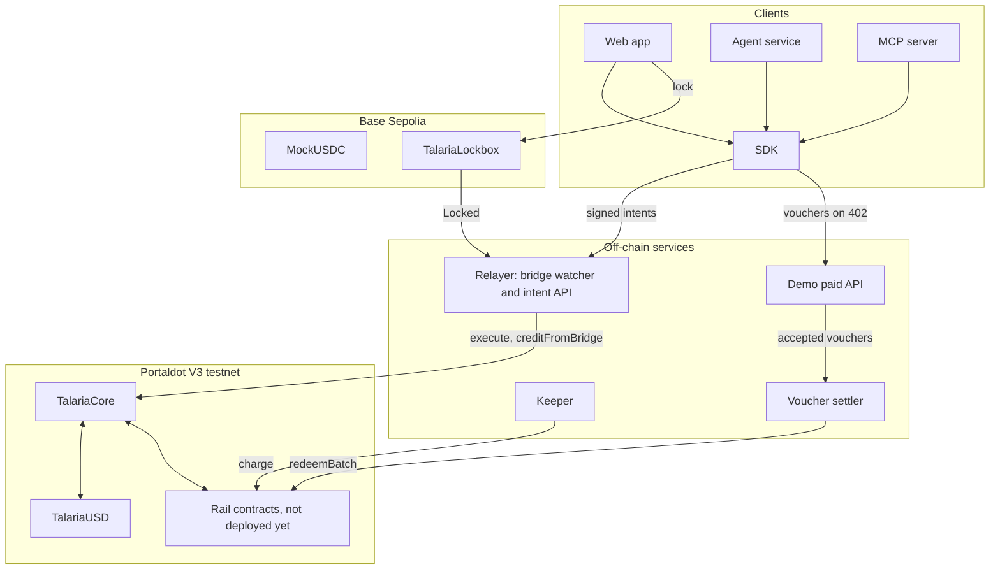

# Architecture

## Payment flow

1. A client builds an intent: rail and action, owner, signer, payee, amount, ref, nonce, deadline.
2. The owner or a session key signs it as EIP-712, with the chain ID and contract address in the domain.
3. Any relayer submits `TalariaCore.execute`. It simulates first, so a reverting call costs nothing.
4. Core checks the deadline, the signer's sequential nonce and the signature.
5. If the signer is a session key, Core checks its expiry and policy. An unknown or expired key reverts. An intent over its limits, or for a rail or payee it may not use, goes to the pending queue for the owner.
6. Core runs the action, and every payment emits `Receipt` with a unique `receiptId`.

## Contract structure

`TalariaCore` holds all tUSD and an internal balance per account. It includes checkout and bridge credit, the two features that must never be cut.

Each other rail is a separate contract registered with `setModule`. A rail escrows funds in Core under its own address and moves them with `railTransfer`. This lets rails deploy one at a time in priority order, which matters because code size costs tPOT. Intents reach a rail through `onIntent`.

The `rail` field of an intent holds the rail in its low 4 bits and the action in its high 4 bits, which keeps the signed type small while covering actions like cancel and withdraw.

## Bridge flow

1. A payer locks mUSDC in `TalariaLockbox`, naming a Portaldot recipient.
2. The relayer waits 2 confirmations, then checks both its own records and `bridgeProcessed`.
3. It calls `creditFromBridge`, which draws from a tUSD reserve funded in advance. `srcTxHash` blocks replay.

The bridge holds one credit per source transaction hash, and amounts are treated as equal value between the two 6-decimal test tokens.

## Pay-per-call flow

1. The API answers `402` with a JSON requirement: channel contract, provider, price.
2. `talaria.fetch` checks the price against `maxPrice`, signs a voucher with a higher cumulative amount, and retries.
3. The API verifies the signature and amount against the channel, then serves the data.
4. The settler redeems only the latest voucher per channel, so many calls become one payment. Calls need no on-chain transaction.

## What deposits cost

Measured on V3, see `evidence/`. Revive constants: 0.06 tPOT per byte of deposit, plus a 30% code-hash lockup.

| Item | Cost |
|---|---|
| Deploying code | About 0.08 tPOT per runtime byte |
| New 32-byte storage slot | About 3.84 tPOT |
| TalariaUSD (3,018 bytes) | 252.69 tPOT |
| TalariaCore (8,539 bytes) | 683.89 tPOT |

The spec's early estimate of 0.0589 per byte plus 18.32 per contract was too low for this runtime. `viaIR` with one optimizer run shrank Core by about 17%. Removing direct functions made it larger, because of reduced inlining.

## Findings about Portaldot V3

From `evidence/probe-chain.json`. Useful to other builders:

- An EVM balance equals (free balance minus the 0.1 tPOT existential deposit) × 10⁴.
- `debug_traceCall` responded on a zero-address call, although the `debugEnabled` constant is false.
- Funding an EVM address by sending to `H160 ‖ 0xEE×12` works: 1 tPOT sent appeared as 0.9 over EVM RPC.
- `autoMap` is true. Whether this removes the need for `map_account` is not verified.
